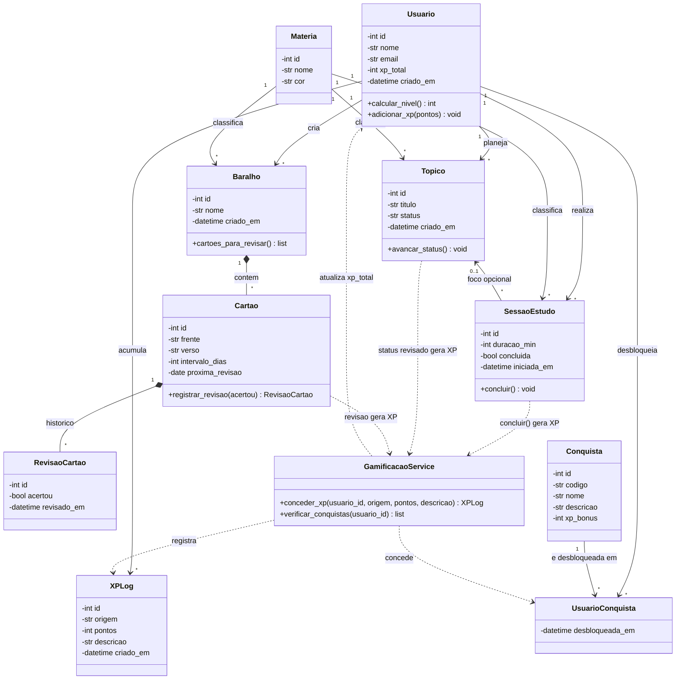

# Diagrama de Classes (UML) - StudyHub

Diagrama de classes do domínio do sistema. O GitHub renderiza o bloco abaixo automaticamente.
O mesmo diagrama está em `diagrama_classes.mermaid`.

## Correspondência entre classes e tabelas do banco

| Classe | Tabela | Observação |
|---|---|---|
| Usuario | `usuario` | `xp_total` é atualizado pelo GamificacaoService |
| Materia | `materia` | catálogo compartilhado por todos os módulos |
| Topico | `topico` | status: `nao_visto`, `estudando`, `revisado` |
| SessaoEstudo | `sessao_estudo` | `topico_id` é opcional |
| Baralho | `baralho` | pertence a um usuário e a uma matéria |
| Cartao | `cartao` | `intervalo_dias` e `proxima_revisao` controlam a repetição espaçada |
| RevisaoCartao | `revisao_cartao` | histórico de acertos e erros |
| XPLog | `xp_log` | origem: `pomodoro`, `topico`, `flashcard`, `conquista` |
| Conquista | `conquista` | `codigo` identifica a regra no GamificacaoService |
| UsuarioConquista | `usuario_conquista` | tabela associativa N:N entre Usuario e Conquista |
| GamificacaoService | (sem tabela) | classe de serviço chamada pelos módulos Pomodoro, Planner e Flashcards |

## Relacionamentos

- **1:N**: Usuario com Topico, SessaoEstudo, Baralho e XPLog; Materia com Topico, SessaoEstudo e Baralho; Topico com SessaoEstudo (opcional).
- **N:N**: Usuario e Conquista, resolvido pela tabela `usuario_conquista`.
- **Composição**: Baralho contém Cartao, e Cartao contém RevisaoCartao (apagar o pai apaga os filhos).
